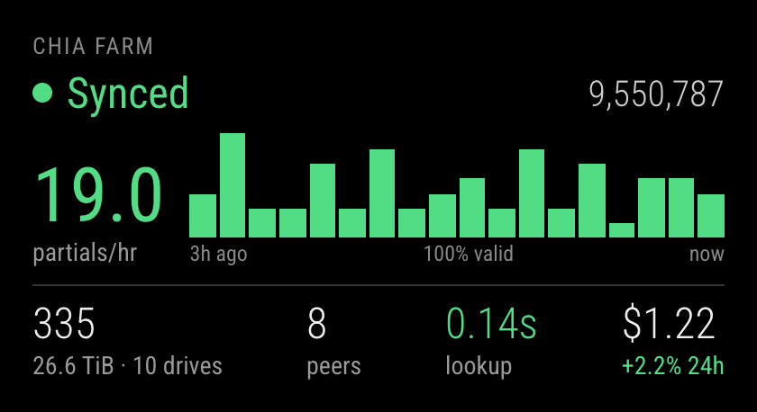

# MMM-ChiaFarm

MagicMirror² module for a Chia farm, read from a
[chia-exporter](https://github.com/Chia-Network/chia-exporter) `/metrics` endpoint. Shows sync
state, height, partials per hour with a three-hour graph, plots and size, peers, lookup time and the
XCH price. Optional: drive checks from [node_exporter](https://github.com/prometheus/node_exporter)
and effort and valid shares from Foxy-Pool.



## Install

```sh
cd ~/MagicMirror/modules
git clone https://github.com/emlowe/MMM-ChiaFarm
```

No npm dependencies.

## Config

```js
{
  module: "MMM-ChiaFarm",
  position: "top_left",
  config: {
    url: "http://chiafarm.local:9914/metrics",
    nodeExporterUrl: "http://chiafarm.local:9100/metrics", // null to turn off drive details
    drivePattern: "^/chia\\d+$", // mountpoints counted as plot drives
    expectedDrives: 10,     // warn when fewer plot drives are mounted (off by default)
    partialWarnMinutes: 20, // warn after this long with no partials; 0 to turn off
    notFarmingMinutes: 10,  // warn after this long with no plots passing the filter; 0 to turn off
    priceCoin: "chia",      // CoinGecko coin ID for the price; null to turn off
    foxyPool: "chia",       // Foxy-Pool pool ID (off by default)
    validWarnPercent: 100,  // valid percentage turns yellow below this
    updateInterval: 60000,
    lookupWarn: 2,          // seconds; lookup time turns yellow above this
    lookupBad: 5            // seconds; red above this
  }
}
```

## Status

**Synced** (green); **Syncing**, **No harvester**, **Not farming**, **Drive missing**, **read-only**
or **No partials** (yellow); **Offline** (red, last-known numbers dimmed).

## Notes

- Partials readings are saved to `history.json`. The rate appears after ten minutes and the graph
  fills in over three hours.
- **Not farming** means no plots have passed the filter for `notFarmingMinutes`.
- With `foxyPool` set, effort and 24-hour valid shares appear under the graph, and the no-partials
  warning uses the pool's last accepted partial. Effort needs one win since joining the pool.
- Price, pool and node_exporter problems never change the farm status.
